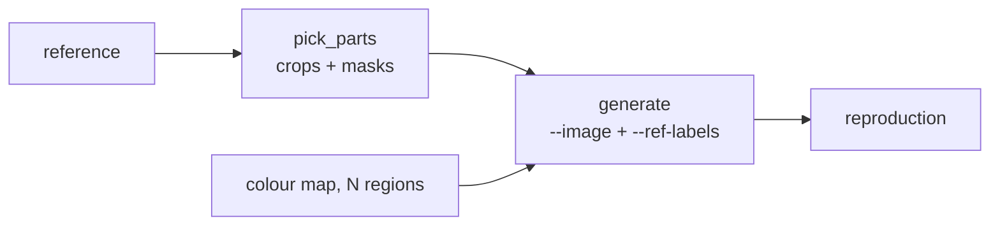
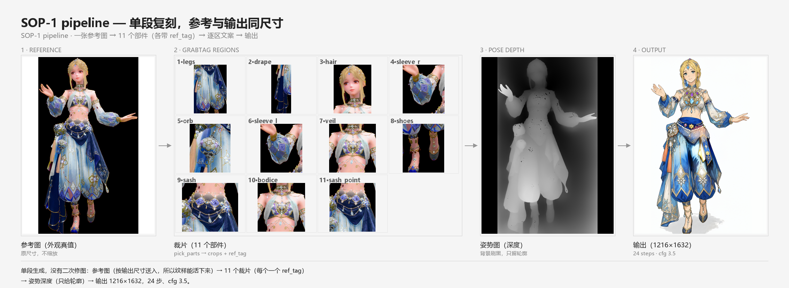
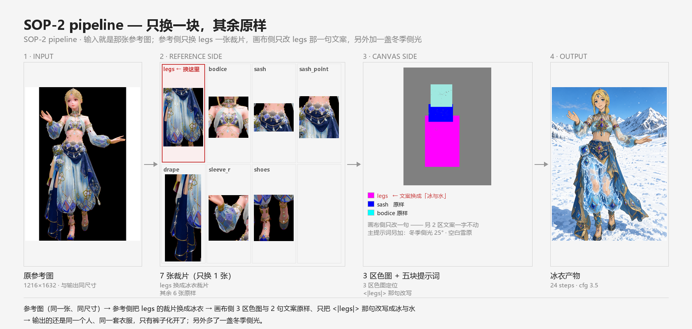
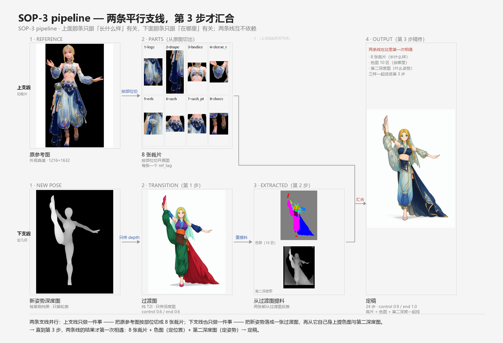

# MOSS GrabTag · region prompt · three SOPs

**English** · [简体中文](README.zh.md)

**Cut a reference image into pieces, give each piece a name, then tell the model which patch of canvas that name refers to.**

A toolkit and three workflows for **controllable outfit reproduction** on MOSS-Image (Qwen3.5-9B text encoder + 5B single-stream DiT).

No matter how clean the reference image is, "what does this particular part look like" rarely lands reliably in the output. The reason is in MOSS's reference channel: it reads the reference as **a semantic hint for the whole image**, not **a library you can fetch from by coordinate**. Say "follow the top from this image" and it reads the whole picture's mood — the top's pattern arrives together with decorations from everywhere else. Say "this patch should carry that pattern" and it has no way to know which patch you mean.

<table>
<tr>
<td width="50%"></td>
<td width="50%"></td>
</tr>
<tr>
<td><sub><b>1 &middot; what you have</b> &mdash; one reference image; every detail is implicit, and the prompt can only gesture at it</sub></td>
<td><sub><b>2 &middot; after regions are cut</b> &mdash; the same outfit painted as N flat colour patches, each with its own caption</sub></td>
</tr>
</table>

*Right is the 10-region colour map, left is its source image. Same size; the patches follow the garment silhouette rather than drawing boxes.*

**No LoRA injection, no style drift.** GrabTag needs no LoRA and injects none: style comes from the base model plus your prompt, not from whatever a fine-tuning dataset happened to prefer — so the same reference can be re-skinned without dragging a whole aesthetic along.

Most reference-image workflows hand the model one picture and hope it remembers the details. This one goes the other direction: **cut the reference into named regions, write one sentence per region, give each sentence a box** — the model is told "this sentence belongs to that box", not "somewhere in this image there is a lotus".

The toolkit splits the problem into two orthogonal directions, each with its own input and injection point:

| Module | Direction | What it solves | Input | Injection point |
|---|---|---|---|---|
| **GrabTag** | reference side → canvas | let a **part** of the reference be pinned to a place | source image + segmentation (crops + masks) | `--image` / `--ref-labels` / `--ref-query-mask-por` |
| **region prompt** | canvas side → canvas | give a **region** of the canvas its own caption | source image + colour map | colour map + two prompt blocks (prepended and appended) |
| **three SOPs** | wiring it together | turn the above into repeatable steps | — | — |

They **do not overlap**: GrabTag owns "this part looks like that", region prompt owns "this region is painted with this pattern". Running both on one image is the standard configuration for SOP-1 / SOP-2 / SOP-3.

---

## GrabTag: binding parts of a reference onto the canvas

### In one line

`--image` to cut, `--ref-labels` to name, `--ref-query-mask-por` to constrain which patch of canvas each piece may govern.

### Two inputs: source image and segmentation

GrabTag eats **two images aligned to the same geometry**:

**1 · Source image (the reference) — what it looks like.** Cut it into at most 8 part crops, each saved as its own file. A long edge of 512 is plenty; anything larger is wasted, since the vision side already downscales to 384.


**2 · Segmentation (masks) — which patch of canvas each crop is allowed to govern.** A black-and-white image of the same size: white = allowed, black = forbidden. Below, the "legs" piece as an example:

<table>
<tr>
<th align="center">crop (what it looks like)</th>
<th align="center">mask (where it may act)</th>
</tr>
<tr>
<td align="center"></td>
<td align="center"></td>
</tr>
</table>

*Same outfit, eight pairs of "crop → mask", one pair per part. Every mask is canvas coordinates — `moss_ref_mask.py` calls it "the canvas region allowed to read reference i", so rotating the reference image changes nothing.*

| Part | Crop | Mask |
|---|---|---|
| bodice |  |  |
| sash |  |  |
| drape |  |  |
| shoes |  |  |

### The three-step setup

1. **Cut** — `pick_parts.py` slices the reference along body parts into at most 8 crops, and writes a mask for each.
2. **Name** — each crop gets a short `ref_tag` describing what is visible in it (colour, material, shape, ornament). This is the handle your prompt will use.
3. **Constrain** — every crop is handed a mask, so it only feeds the patch of canvas you allow it to.

### Technical implementation

- **Vision-token path.** Crops travel as `images.image_N`; the node builds `marks = ["label:" ...]` so a crop is only read when the prompt names its label.
- **Per-reference masks.** `--ref-query-mask-por` takes one mask per crop and applies it at the image-token level (`comfy/ldm/moss_image/model.py:409-415`), before the reference attends to anything.
- **Token budget.** Each crop costs roughly 320 tokens; the model's vision side scales a long edge to 384 regardless of the file you pass.
- **8 pieces is the ceiling** — one per reference slot; beyond that you are better off with region prompt.
- **OOM guard** (see next section) — the default already avoids the precomputed-KV blow-up.

### Reference-image OOM: `MOSS_NO_REF_PRECOMPUTE=1`

Large references used to make the KSampler die with `Allocation on device 0 would exceed allowed memory ... Requested 3~8 GiB`, or the process simply vanished. The cause is a precomputed KV tensor in `comfy/model_base.py:2963-2965`:

```python
kv = x.new_empty((B, len(layers), 2) + x.shape[1:])
#  28 layers x 2 (K/V) x n_ref x 4096 x 2B  ≈  0.44 MiB per token
#  7232 tok  -> 3.2 GiB
#  16320 tok -> 7.5 GiB   (fatal on an 8 GB card)
```

Two guards, both environment variables:

| Variable | Default | What it does |
|---|---|---|
| `MOSS_NO_REF_PRECOMPUTE=1` | `1` (since 2026-11-09) | skip precomputing KV; pass `ref_latents` straight through — **this is the fix** |
| `MOSS_REF_POOL=2` | `0` | average-pool the reference before encoding — saves memory, costs high-frequency detail |

Measured on 1216×1632 with about 7752 tokens of reference: the default build crashed twice (process disappeared); with the switch on it finished in **61 s** and kept the most detail. Log line to confirm:

```
[moss-ref] precompute OFF (MOSS_NO_REF_PRECOMPUTE=1) -> ref_latents passthrough
```

Three things worth knowing:

1. **Patching the wrong file does nothing.** It has to be `comfy/model_base.py`, before `preprocess_refs()`. Editing `comfy/ldm/moss_image/model.py` is useless — the KV is already materialised by then (that is why four earlier attempts failed).
2. **It is not merely a debugging switch.** It is the production default now.
3. **`MOSS_REF_POOL` trades resolution.** Use pooling only when you cannot avoid it.

To restore the old behaviour set `MOSS_NO_REF_PRECOMPUTE=0`, but there is no reason to unless you are bisecting.

### Four hard requirements (with measured consequences)

| Requirement | Consequence of violating it |
|---|---|
| Every piece needs a `<tag>` reference | mounting crops with no reference = completely inert (vs-reference `131.01`, worse than not mounting at all) |
| Write it reversed (part → crop) | writing "`<tag>` is …" forwards produces floating objects (off by `5.85`) |
| Do not describe appearance (material/silhouette/boundary) | worth `+3.2` on legs but `-6.6` on the bodice — a net loss |
| Keep the two closing sentences | otherwise stray braids and ornament pieces appear |

### Comparison: whole-image reference vs per-part binding

Handing over one whole reference and cutting it into named pieces differ not in "how much is referenced" but in **whether you can point at something**.

A whole-image reference travels as vision tokens: the model receives "the mood of this entire picture". Say "follow the top from this image" and it reads the whole picture's semantics — the top's pattern arrives together with decorations from elsewhere, and it cannot know which patch you mean by "this part".

Per-part binding takes that apart:

| | whole-image reference | per-part binding (GrabTag) |
|---|---|---|
| Which patch of canvas a piece governs | cannot be specified | pinned by the `--ref-query-mask-por` mask |
| When the prompt omits a tag | still acts globally | that piece does not participate (mask is 0) |
| Swapping one piece's material | rebuild the whole reference | swap that one crop, nothing else moves |
| Ceiling similarity | **higher** | slightly lower |

That last row is the cost, and it is measured: **if you want maximum resemblance, a whole-image reference wins** — GrabTag trades information for localisation. A second measurement points the same way: the deeper the reference reaches, the less high-frequency structure the image itself keeps (same seed, five arms, sharpness: no reference `445` → colour map `424` → whole image `414` → same-size reference `392`).

So they are not substitutes: **GrabTag decides which crop a patch belongs to; what it looks like is filled in by region prompt and the caption**. Conversely, if all you need is "broadly like this image" and no part-by-part naming, mounting the whole image is less work.

---

## region prompt: giving every region its own sentence

### In one line

**Region assignment on the canvas side: one colour map to delimit regions + one sentence per region.**

It does **not** handle silhouette, overall layout or pose — the silhouette comes from the depth map, the appearance comes from GrabTag's crops. It handles exactly one thing: **telling the model what this patch of canvas should look like**.

### Two inputs: source image and colour map

<table>
<tr>
<th align="center">1 &middot; source image (the one being reproduced)</th>
<th align="center">2 &middot; colour map (10 regions, one caption each)</th>
</tr>
<tr>
<td></td>
<td></td>
</tr>
</table>

Four rules for drawing the colour map (each backed by a measurement):

| Rule | Why |
|---|---|
| **Shapes must hug the garment silhouette** | rectangles produce multiple people (measured non-white area 41% → 81%) |
| **Background must be mid-grey `(128,128,128)`** | a white background destroys the pose (forced into front-facing standing); black also drifts |
| **Region count is capped by the number of non-overlapping parts** (not a fixed 3) | colour bleed measured at 3 / 5 / 8 / 9 regions was all `0.000%` — colour was never the bottleneck; the real bottleneck is **mask pixel overlap** — when two masks overlap >90%, whichever is painted later covers the earlier one (`veil` covering `bodice` dropped its saturation from 33.38 to 29.11) |
| **Above 3 regions you need `--control-strength 1.0 --depth-strength 1.0`** | with more than 3 regions the colour hints overpower the body silhouette, so the depth map has to absorb them into cloth panels |

Colours come from the 10-swatch palette in `tools/detail_colormap.py:36`; take the first N in order:

```
#ff00ff  #0000ff  #00ff00  #ff8000  #8000ff
#00ffff  #ff0000  #80ff00  #ff0080  #0080ff
```

Minimum colour distance is 255 for 2–4 colours and drops to 127 from 5 upward (closest pair `#ff00ff ↔ #8000ff`). **Do not invent your own colours** — especially not anything close to the reference's dominant colours; that gets read as a fill instruction.

### How it works

A complete region prompt has **three parts**:

```
the <hex> area is <tag>, <position>;
its shape is: <trunk>.
Its colours, patterns and materials: <details>
```

Each part does one job:

- **`is <tag>`** — points this colour region **back at a GrabTag crop**. The tag is the bridge between the two modules.
- **`shape is <trunk>`** — silhouette (harem trousers, wide sleeves, a hanging sash). Shape only, no material.
- **`colours, patterns and materials`** — colour + pattern + material. The largest part: counts, arrangement, colour and material of each ornament, attached details.

A real one (the `legs` region):

```
the #ff00ff area is legs, her legs from waist to ankle;
its shape is: wide loose trousers with a voluminous, ankle-length silhouette.
Its colours, patterns and materials: gold-thread vertical stripes running parallel
down the front of each leg; navy-edged diamond appliqués in four rows per leg,
each diamond set with a pale blue gem, linked by gold chains hung with red-brown
beads and small silver star pendants.
```

**Resolution ceiling is 16 px per cell** (VAE stride 16) — it can place things, it cannot specify anything finer than 16 px. So "four diamonds" works; "diamonds with a 12-pixel edge" does not.

### Why the prompt is split into a front part and a back part

**Because the injection point differs in the program.**

In `moss_run.py:462-491` region prompt has three independent routes, with different prefixes and opposite injection points:

| Flag | Prefix | Injection point | Code |
|---|---|---|---|
| `--region-prompt-head` | `Region key: ` | **prepended to the prompt** | `moss_run.py:465-470` |
| `--region-prompt` | `Colour key: ` | **appended to the prompt** | `moss_run.py:472-478` |
| `--region-concat` | — | each encoded as its own conditioning, chained with `ConditioningConcat` | `moss_run.py:479-491` |

The two lines for the back part, verbatim:

```python
key = "Colour key: " + " ".join(rp)
g["7"]["inputs"]["prompt"] = g["7"]["inputs"]["prompt"] + "\n\n" + key
```

Why split that way:

- **Front part carries *position*.** The comment at `moss_run.py:467` says it plainly: "same format as `--region-prompt`, but prepended to the prompt (where layout's positional sentence used to sit)". Who is on the left, who is on the right, what hangs below the waist — spatial pointers have to appear early so the model builds the skeleton first.
- **Back part carries *material*.** A colour-to-material mapping is essentially a colouring description of an already-shaped image, so putting it last lines up with "how to fill the outline that exists". The comment at `moss_run.py:474-475` records the tradeoff: writing "colour = material" into **the same prompt block** works far better than concatenating several conditionings, with `--color-map` handling placement only.
- **The third route (concat) is a fallback, not recommended.** It encodes each region's caption as an independent conditioning and chains them, which sounds "cleaner" but measured worse than one merged block.

In one sentence: **this is not a style choice, it is a consequence of the injection point.** The front part speaks before the skeleton exists; the back part paints once the image has formed.

### Technical implementation

- **`--color-map`**: enters `MOSSImageControl`'s 384 channels (128 noise + 128 color + 128 depth, see `custom_nodes/comfyui-moss-ref-bias/moss_control_embedder.py:92-103`), downsampled to a 16×16 latent grid, each latent cell taking its dominant colour.
- **Both prompt blocks**: both go through `TextEncodeMOSSImageEdit`'s `prompt` field, only the splice position differs (see the table above). So they do not interrupt each other; they occupy the head and tail of the text sequence.
- **Boundary with GrabTag**: GrabTag travels on `images.image_N` (visual channel), region prompt travels on `prompt` (text channel); they are independent. Running both on one image is the standard SOP-1 setup.

### Comparison: layout bbox vs colour map

MOSS already had a region-assignment route: give each part a bbox, which is internally converted to a colour map (`_layout_to_colormap`). So the two are **not two features but two entrances to the same feature** — injection layer, channel and localisation precision are all identical:

```
colour map PNG (whether generated by layout or drawn by hand)
  → VAE encode → 128-dim latent      ← precision is fixed here: one 16×16 cell
  → cat([color, depth]) * strength → concat_latent_image(256)
  → concatenated with the noise latent → 384 channels → video_embedder → DiT
```

**layout's localisation is no worse than a colour map, and a colour map is not "more accurate"** — before the VAE both are canvas pixels, after it both are the same latent image, both limited to 16 px per cell. The only real differences are four, all upstream:

| | layout bbox | colour map |
|---|---|---|
| Shape | **rectangles only** (`draw.rectangle()`, no non-rectangular path) | **any shape**: hugs the silhouette, multiple disconnected patches, holes allowed |
| Sub-regions inside one part | no (one box per part) | yes (one part can be cut into several) |
| Default background | white 255 → **drags the pose** (measured: forced into front-facing standing) | mid-grey 128 → pose survives |
| Caption position | prompt **head** (positional sentence) → global influence; a large bbox pollutes the background (49.4% of the corners) | prompt **tail** (colour-key sentence) → more local |

The second row is what this workflow actually depends on: `legs` can be split into thigh / knee / calf / ankle segments, and `sash` and `sash_point` can be regions of their own — **rectangles cannot do that**.

layout has its strengths too, no point pretending otherwise: unlimited colour count (automatic palette, no risk of background collisions) and more direct size control (one box pulls the body shape back, measured 8.34 → 1.59). It only lacks "non-rectangular".

One shared ceiling: **neither carries high-frequency pattern**. Reproducing a specific fabric motif still needs crops + captions — both the colour map and the bbox only say "this patch is yours".

---

## The three SOPs

Wiring the two modules into repeatable flows:

| SOP | What it does | In one line |
|---|---|---|
| **SOP-1 reproduce** | reproduce the same outfit from one reference | cut crops → tag each piece → 10-region colour map → describe each region |
| **SOP-2 adjust one part** | change a single part, leave the rest untouched | swap that one crop and its caption in the SOP-1 setup, everything else identical |
| **SOP-3 change the pose** | keep the outfit, replace the pose | depth map for the new pose → pure-T2I transition image → extract colour map + second depth from it → 8 crops for the final pass |

Full commands and checkpoints live in `notes/SOP-1-原图复刻流程.md`, `SOP-2-原图调整流程.md`, `SOP-3-更换姿势流程.md`; samples under `examples/`.

### The shape of each pipeline

All three take "reference + captions"; they differ in **which channel carries the geometry**.

**SOP-1 reproduce — the reference and the colour map both carry it**



**SOP-2 adjust one part — swap one piece, keep the rest**


**SOP-3 change the pose — geometry goes to the depth map**


**The key difference**: SOP-1's geometry comes from the reference itself; SOP-2 only moves one piece so the geometry is unchanged; SOP-3's geometry comes **entirely from the new depth map** — the reference channel lends "what it looks like", never "where it goes".

> These three diagrams line up with steps 1 / 2 / 3 in `notes/SOP-3-更换姿势流程.md`: step 1 passes only `--depth-map`, step 2 mounts no images and only processes data, step 3 finally mounts the 8 crops together.

### Case SOP-1 — single pass, reference at the output's size

[](examples/SOP-1-20261112-四星2冰蓝舞娘/README.md)

*One pass, no second-stage touch-up: **reference** (fed at the output's size, so patterns survive) → **GrabTag crops** (11 parts, each with its own `ref_tag`) → **pose depth** (silhouette only) → **output** 1216×1632, 24 steps, cfg 3.5.*

Full walkthrough in [`examples/SOP-1-20261112-四星2冰蓝舞娘`](examples/SOP-1-20261112-四星2冰蓝舞娘/README.md) · pipeline doc [`notes/SOP-1-原图复刻流程.md`](notes/SOP-1-原图复刻流程.md) · region captions [`notes/手册-region-prompt.md`](notes/手册-region-prompt.md) · OOM guard see [`MOSS_NO_REF_PRECOMPUTE`](#reference-image-oom-moss_no_ref_precompute1)

---

### Case SOP-2 — swapping one piece: trousers turning to ice

[](examples/SOP-2-20261112-四星2冰衣-24step/README.md)

*The input is that reference image: on the **reference side** only the `legs` crop becomes ice-work while the other 6 stay untouched; on the **canvas side** the 3-region colour map and 2 of the 3 captions stay untouched, and only the `<|legs|>` sentence is rewritten to "ice and water"; plus one extra winter side light at 25°. Three things that are easy to get wrong: the trousers are not "turning into ice" but **`no cloth at all`**; the ice must be transparent enough to see the legs through, with white only on the thin cut edges; the deep violet-blue diamond appliqués and gold trim at the ankle cuff **are still hard**.*

Full walkthrough in [`examples/SOP-2-20261112-四星2冰衣-24step`](examples/SOP-2-20261112-四星2冰衣-24step/README.md) · pipeline doc [`notes/SOP-2-原图调整流程.md`](notes/SOP-2-原图调整流程.md)

---

### Case SOP-3 — changing the pose: two parallel branches that only meet at step 3

[](examples/SOP-3-20261112-四星2-standing-split/README.md)

*Two independent lines. The **upper branch** does one thing — cut the source reference into 8 crops by body part (it only knows "what things look like"). The **lower branch** also does one thing — turn the new pose into a transition image, then extract a colour map and a second depth map from that image itself (it only knows "where things go"). Not until step 3 do the 8 crops + colour map (placement) + second depth map (pose) meet for the first time. All geometry comes from the depth map; the reference channel lends appearance only, never position.*

---

## Requirements

| Item | Version |
|---|---|
| Python | 3.10+ (measured on 3.12.14) |
| Pillow | 13.0.0 |
| numpy | 2.5.4 |
| opencv-python | only for `tools/depth_to_mask.py` |
| transformers | only for `tools/depth_from_image.py` (pulls `depth-anything/Depth-Anything-V2-Small-hf`) |
| MOSS-Image + ComfyUI | not in this repo; deploy it yourself (on the dev box it lives in `C:\MOSS-Deploy\`) |

The `C:\MOSS-Deploy\…` paths inside the scripts are the original machine's deployment paths — change those constants when moving. Scripts that call a vision model to re-describe images (`ground_regions` / `describe_*` / `region_ask`) need reachable model endpoints.

---

## Quick start

Using the SOP-3 standing-split sample as the example (the boxed commands produce the checked-in artefacts):

```bash
# step 0: depth map → character silhouette + blacked-out background
python tools/depth_to_mask.py pose_depth.png input/s4 --width 1216 --height 1632 --feather 2

# step 1: pure-T2I transition image (depth only, control held at 0.6)
python C:/MOSS-Deploy/moss_run.py --fast --w 1216 --h 1632 --seed 9001 \
  --depth-map input/s4_black.png --control-strength 0.6 --control-end 0.6 \
  --prompt-file work/prompt_trans.txt

# step 2: extract the colour map (10 regions) from that image, derive the second
#         depth map, and derive canvas masks from the colour map
python tools/extract_colormap.py output/transition.png --palette palette11.json --out input/s4_cm.png --stats

# step 3: A+B final pass (8 crops + colour map + depth map + canvas masks)
python C:/MOSS-Deploy/moss_run.py --fast --w 1216 --h 1632 --seed 9001 \
  --edit-format ai-toolkit --image "input/e9_legs.png:raw, …" \
  --ref-labels 'legs,drape,bodice,…' \
  --ref-query-mask-por "input/cvm_legs.png, …" \
  --color-map input/s4_cm.png --depth-map input/s4_depth2.png \
  --control-strength 0.9 --control-start 0 --control-end 1.0 \
  --image-strength 0.5 --ref-no-pos 1 \
  --prompt-file work/prompt_main_blocks.txt \
  --region-prompt-file work/rp_s4.txt
```

Full commands and per-step checkpoints in [SOP-3](notes/SOP-3-更换姿势流程.md); artefacts to compare against in [`examples/SOP-3-…-standing-split/`](examples/).

---

## What is in the repo

The three sections below list the executables and documents per module; the samples for the three SOPs live under `examples/`.

### GrabTag

#### Executables

| File | Purpose |
|---|---|
| [`tools/extract_colormap.py`](tools/extract_colormap.py) | extract a colour map from a transition image using a palette (one of the two inputs to GrabTag's two-pass flow) |

#### Documents

| File | Contents |
|---|---|
| [手册-GrabTag.md](notes/手册-GrabTag.md) | what it is, two usage modes, flags |
| [手册-GrabTag-使用.md](notes/手册-GrabTag-使用.md) | step-by-step operation |
| [机制-GrabTag-当前实现.md](notes/机制-GrabTag-当前实现.md) | how it works at code level (reference latents → attention KV) |
| [机制-三个定位系统-GrabTag-layout-色图.md](notes/机制-三个定位系统-GrabTag-layout-色图.md) | GrabTag vs layout vs colour map: three localisation mechanisms, their differences and overlaps |
| [流程-GrabTag两步生成-锁定版.md](notes/流程-GrabTag两步生成-锁定版.md) | the locked two-pass flow |
| [2026-11-10-GrabTag-ref_tag-可见细节写法.md](notes/2026-11-10-GrabTag-ref_tag-可见细节写法.md) | six rules for `ref_tag`: colour/material + category + pattern + position |

---

### region prompt

#### Executables (in call order)

| File | Purpose |
|---|---|
| [`tools/ground_regions.py`](tools/ground_regions.py) | 2D grounding with Qwen3-VL, crops by body part → `grounding.json` |
| [`tools/describe_crops.py`](tools/describe_crops.py) | re-describe every crop in detail, producing a `--region-prompt` draft |
| [`tools/describe_parts.py`](tools/describe_parts.py) | cut by body part, describe each, separating trunk from details → `parts.json` |
| [`tools/describe_subzones.py`](tools/describe_subzones.py) | slice part masks vertically and describe each segment (captures counts like "how many") |
| [`tools/region_ask.py`](tools/region_ask.py) | given an image + a position, ask "what is this?" |
| [`tools/bbox_to_layout.py`](tools/bbox_to_layout.py) | `grounding.json` bboxes + descriptions → MOSS `layout.json` |
| [`tools/parts_to_layout.py`](tools/parts_to_layout.py) | `parts.json` → trunk prompt + both layout channels |

#### Documents

| File | Contents |
|---|---|
| [手册-region-prompt.md](notes/手册-region-prompt.md) | the three-part format, what each part carries, length budget, common mistakes |

---

### The three SOPs

| SOP | Purpose | Reference metric |
|---|---|---|
| [SOP-1 reproduce](notes/SOP-1-原图复刻流程.md) | generate the same outfit from a reference, yielding a clean baseline | vs-reference 126.04 |
| [SOP-2 adjust one part](notes/SOP-2-原图调整流程.md) | change a single part on the SOP-1 output (e.g. trousers turned to ice) | ice outfit 19.17 |
| [SOP-3 change the pose](notes/SOP-3-更换姿势流程.md) | keep the character and outfit, replace the pose | 627 lines, two cases: kneeling + standing split |

#### SOP-specific executables

| File | Purpose |
|---|---|
| [`tools/pick_parts.py`](tools/pick_parts.py) | pick key parts from `parts_all.json` → cut crops + cut masks |
| [`tools/depth_to_mask.py`](tools/depth_to_mask.py) | depth map → character silhouette mask + blacked-out depth map (Otsu + morphology + largest component + hole filling) |
| [`tools/clean_depth.py`](tools/clean_depth.py) | black out a depth map's background (SOP step 0) |
| [`tools/detail_colormap.py`](tools/detail_colormap.py) | `details[]` → per-region colour map + region prompt captions |

#### Samples

Four self-contained samples, each with `00-*` … `05-*` step artefacts plus its own README:

```
examples/
├── SOP-1-20261112-四星2冰蓝舞娘/          36 files / 6.2 MB
├── SOP-2-20261112-四星2冰衣-24step/       38 files / 7.5 MB
├── SOP-3-20261112-四星2跪姿/               9 files / 4.1 MB
└── SOP-3-20261112-四星2-standing-split/   25 files / 7.1 MB
```

Inside a SOP-3 sample:

```
00-depth/        blacked-out depth map (ex3_black.png feeds --depth-map, ex3_mask.png for inspection)
01-transition/   transition image (depth only, control 0.6 / end 0.6)
02-colormap/     colour map + second depth map + 8 canvas masks cvm_*.png
03-prompt/       main prompt (five-block layout) + region prompt (three-part format)
04-output/       every variant, including failed ones for comparison
README.md        per-arm numbers and the traps hit along the way
```

---

## CLI cheat sheet

| Script | Required | Common options |
|---|---|---|
| `extract_colormap.py` | `--out` | `--palette` (defaults to palette11.json), `--stats` |
| `ground_regions.py` | `--image` `--outdir` | `--labels` `--max-edge` |
| `describe_crops.py` | `--indir` `--out` | `--only` `--max-edge` |
| `describe_parts.py` | `--grounding` `--image` `--out` | `--max-edge` |
| `describe_subzones.py` | `--ref` `--mask-dir` `--out` | `--segments` |
| `region_ask.py` | — | `--region x,y,w,h` / `--point x,y` / `--question` |
| `bbox_to_layout.py` | `--grounding` | `--tags` `--out` |
| `parts_to_layout.py` | `--parts` | `--min-area` `--max-area` `--prompt` `--layout` |
| `pick_parts.py` | `--parts` `--ref` | `--w` `--h` `--prefix` `--max` |
| `depth_to_mask.py` | `<input>` `<output-prefix>` | `--width` `--height` `--feather` `--roi` `--keep-floor` |
| `clean_depth.py` | `--depth` | `--ref` `--out` |
| `depth_from_image.py` | `<input>` `<output>` | none (positional; model fixed to `Depth-Anything-V2-Small`) |
| `detail_colormap.py` | `--parts` | `--picked` `--input-dir` `--out-colormap` `--out-prompts` |

All of them support `--help`.

---

## Not in this repo

- The MOSS-Image model, the ComfyUI deployment, `moss_run.py` / `moss_main.py`
- Reference images, asset library, training sets, working drafts
- **Further reading**: this repo only carries the documents the three SOPs **name directly** (15 notes md). Those documents in turn reference more notes (the measured chain reaches 15 files outside this repo within three hops), and chasing it recursively snowballs, so they are not included. When a SOP mentions a `.md` that is not here, that is an internal workspace document — fetch it from `notes/` by filename.

---

## Three verified conclusions

1. **Masks are canvas coordinates, not reference-image coordinates** — `--ref-query-mask-por` masks say "which region of the canvas is allowed to read reference i". After a pose change the old and new geometry do not line up (`drape` IoU 0.00%), so the `cvm_*.png` masks must be derived from the new colour map.

2. **`--control-strength` and `--image-strength` do two different jobs** — the former is the master gain for colour map + depth map (`1.0` lets reference crops be painted into the frame as decoration, collage 73.4%; `0.9` is the balance point), the latter governs how much the reference influences the image overall (`0.5` pushes collage down to 4.3% without degrading patterns).

3. **24 steps amplifies material words** — writing `sheer fabric` in a region prompt measures fine at 8 steps with `--fast`, but at 24 steps the material prior blows it up into full transparency (trouser legs drop from (129,167,185) blue to (175,181,182) grey-white). Raising `--image-strength` does not help; the trunk has to be rewritten as explicitly opaque.

---

## Verification log

Measured before the first push:

| Item | Result |
|---|---|
| `git fsck --strict` | clean |
| 133 file blobs vs the index | all match, 0 anomalies |
| Markdown relative links | 25 valid, 0 broken |
| PNG readability | all 84 open (48 of them the 1216×1632 main canvas) |
| `--help` on 12 scripts | all rc=0, no warnings |
| Example JSON cross-reference | SOP-1 / SOP-2 each 11 parts / 7 picked, 0 missing crops or masks |

---

## Licence

MIT — see [`LICENSE`](LICENSE).

The repo only carries the documents and scripts the three modules name directly; for further reading, fetch from your local `notes/` by filename.

---

## Repository topics (GitHub)

Fill these into the Topics box next to the About panel. Ten of them:

```
moss-image  comfyui  image-generation  reference-image  regional-prompting
pose-transfer  controlnet  depth-map  inpainting  diffusion-workflow
```

And the About description (limit 350 characters, this one is 294):

```
Two advanced tools for MOSS-Image that supersede plain image-edit and bbox
layout: GrabTag pins named reference crops to canvas regions, region prompts
caption each region separately. Three SOPs included as walkthroughs. No LoRA
or adapter to load - more freedom, steeper curve, higher ceiling.
```

---

*Every example image in this document is a real artefact from a run under `examples/`, not a mock-up.*
