# MOSS GrabTag / region prompt / 三条 SOP

在 MOSS-Image（Qwen3.5-9B 文本编码器 + 5B 单流 DiT）上做**可控换装出图**的一套工具与流程。

参考图给得再清楚，「哪个部位长什么样」也很难稳定落到生成结果里。原因在 MOSS 的参考通道：它把参考图当成**一整张图的语义提示**读进来，而不是**一张能按坐标取料的图库**。你说「照这张图的上衣」，它读到的是整张图的气质，上衣的纹样和别处的装饰一起涌进来；你说「这块要那个纹样」，它也无从知道「这块」指画面哪里。

这套东西把问题拆成两个正交的方向，各有独立的输入与注入位置：

| 模块 | 方向 | 解决什么 | 输入 | 注入位置 |
|---|---|---|---|---|
| **GrabTag** | 参考侧 → 画布 | 让参考图的**部位**被准确定位 | 原图 + 分割图（裁片 + 掩码） | `--image` / `--ref-labels` / `--ref-query-mask-por` |
| **region prompt** | 画布侧 → 画布 | 让画布的**区域**有独立文案 | 原图 + 色图 | 色图 + 两段提示词（拼在 prompt 首尾） |
| **三条 SOP** | 串流程 | 把上面两块固化成可重复执行的步骤 | — | — |

两者**不重叠**：GrabTag 管「这个部位长成那样」，region prompt 管「这块区域画成这个纹样」。同一张图上两个都开，是 SOP-1 / SOP-2 / SOP-3 的标准做法。

---

## 一、GrabTag：把参考图的部位绑到画布上

### 一句话

`--image` 切块 + `--ref-labels` 命名 + `--ref-query-mask-por` 限定每块能管画面哪一块。

### 两样输入：原图 与 分割图

GrabTag 吃的是**两张对齐到同一套几何的图**：

**① 原图（参考图）—— 长什么样。** 按人体部位切成最多 8 块裁片，每块单独存成文件。最长边 512 就够，更大没用 —— vision 侧本来就缩到 384。

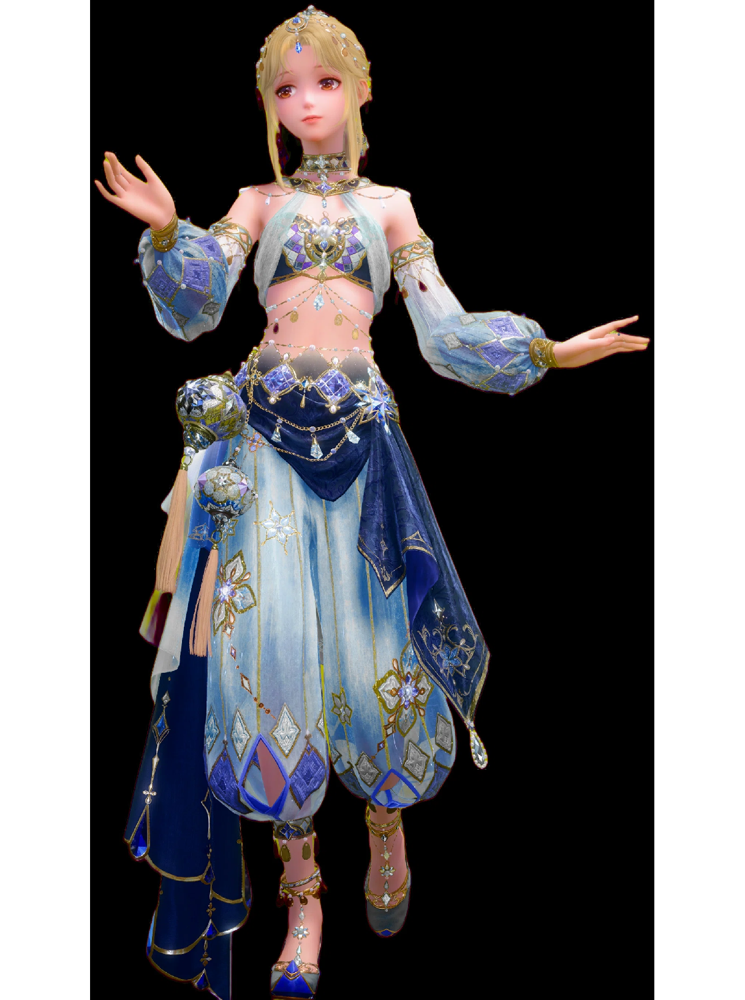

**② 分割图（掩码）—— 每块裁片允许负责画面哪一块。** 同尺寸黑白图，白色 = 允许，黑色 = 不许。下面以「腿」这一块为例：

<table>
<tr>
<th align="center">裁片（长什么样）</th>
<th align="center">掩码（能管画面哪儿）</th>
</tr>
<tr>
<td>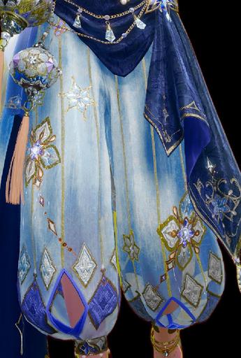</td>
<td>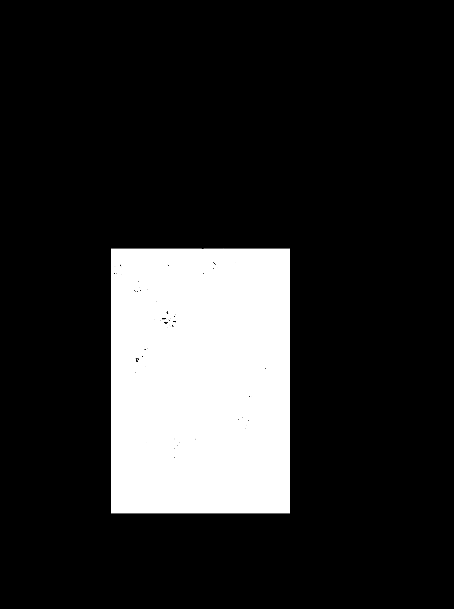</td>
</tr>
</table>

同样一套「裁片 → 掩码」按部位各来一份，8 块就是 8 对：

| 部位 | 裁片 | 掩码 |
|---|---|---|
| 胸衣 | 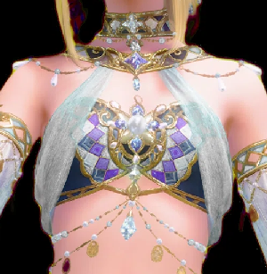 | 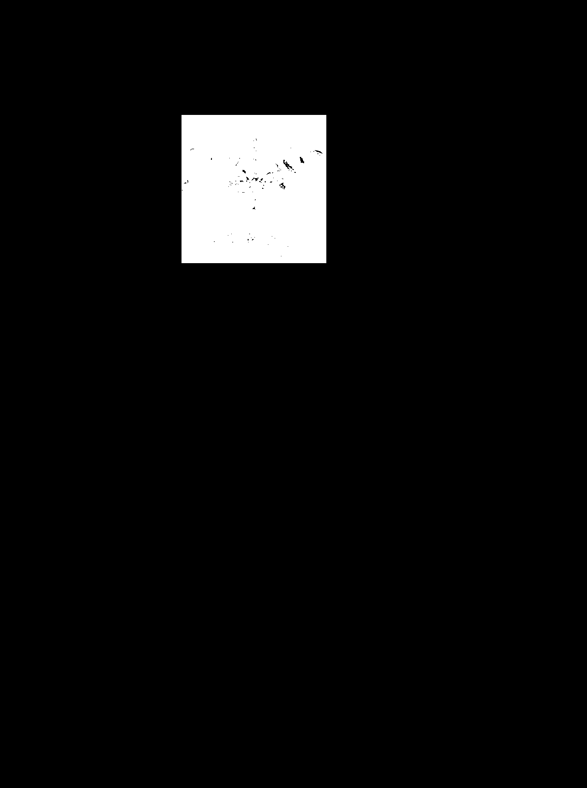 |
| 腰带 | 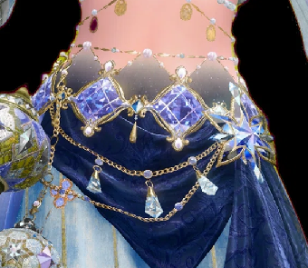 | 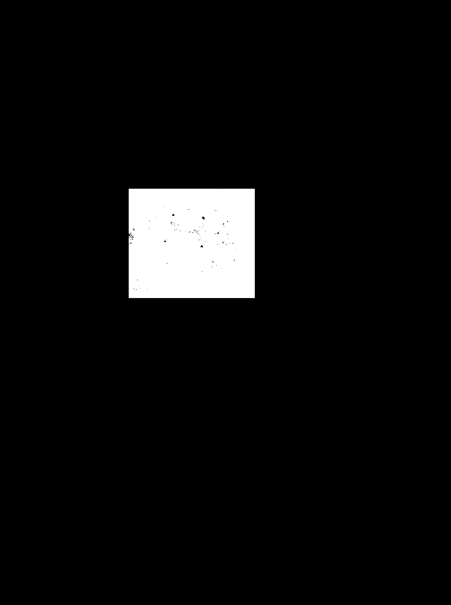 |
| 垂布 | 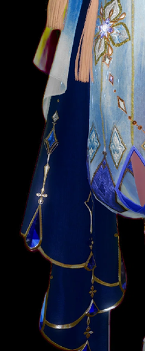 | 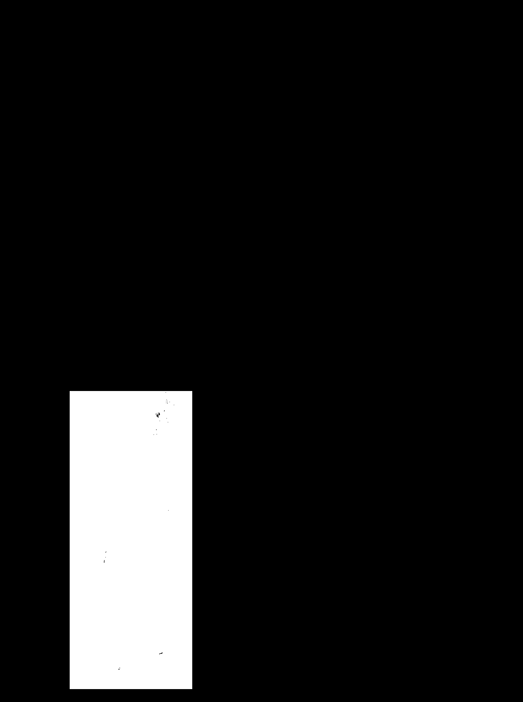 |
| 鞋 | 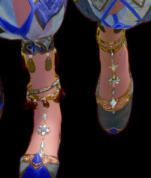 |  |

两张图分开保管、分开传参：

- 裁片走 `--image hair.png:raw, bodice.png:raw, …`，**`:raw` 必须带**（不带会走缩略图路径，裁片细节全丢）
- 掩码走 `--ref-query-mask-por hairm.png, bodicem.png, …`

三个存储约束（都踩过）：

1. **必须放 `ComfyUI\input\` 根目录** —— 子目录会报 `Invalid image file`
2. **用统一前缀**（如 `gtm2_`）—— input 里有同名旧文件会被静默用错
3. **掩码是「画布坐标系」的，不是裁片坐标系** —— 最容易错的一点：在裁片坐标系下画的掩码，等于让这块裁片去管画面上的错误位置

### 三步设定

**第 1 步：切裁片。** 按人体部位切，一部位一块，最多 8 块。bbox 是参考图上的像素坐标 `(x0,y0,x1,y1)`，由 `tools/ground_regions.py`（`qwen3-vl-plus` 做 2D grounding）自动产，或手量。

**第 2 步：切掩码。** 每块裁片对应一张同尺寸黑白图，白区就是它在画布上能负责的范围。这一层是 GrabTag 的核心 —— **没有掩码，8 块裁片会一起抢整张画面**，结果是每种纹样都糊在所有地方。

**第 3 步：写提示词。** 一个部位一句，格式固定：

```
Her long braided hair is <hair>.
Her upper chest and bust are covered by <bodice>.
Her waist is wrapped in <sash>.
Her legs, from waist to ankle, are <legs>.
```

`<tag>` 与 `--ref-labels` 里的名字**逐字对应**，且不写任何形貌描述（材质、轮廓、边界一律不写）。末尾两句别省：

```
For every named body region, use the garment from the reference given for that region and no other.
Do not draw any of these parts as separate objects beside the figure; each is worn on the body.
```

省了会冒出漂浮的辫子和装饰片。

### 技术实现

- **`--image` + `--ref-labels`**：把 8 张裁片以 vision token 形式送进文本编码器，并按 `--ref-labels` 的顺序给它们起名。日志出现 `[moss] ref-labels 'hair,veil,bodice,…': 用自定义 tag 代替 Picture N 标记参考` 才算生效。
- **`--ref-query-mask-por`**：掩码决定**哪块裁片能读画面哪一块**。实现在 `comfyui-moss-ref-bias/moss_ref_mask.py:65-66`，原文是「mask i is the canvas region allowed to read reference i」；`comfy/ldm/moss_image/model.py:409-415` 把掩码 interpolate 到 latent 的 `(H,W)` 后，对画面 token 做 `masked_fill_`。
- **`--ref-no-pos 1`**：不传则参考会连自己的布局一起复刻，压过一切；传了只借内容、不借位置。
- **`--image-strength`**：参考整体权重。1.0 时参考的装饰容易溢出成「画面旁边多画一个挂坠」这类拼贴；0.5 附近可压到 0.00%（实测）。
- **8 块上限**：不是软件限制，和 region prompt 的色区上限是同一件事 —— **互不重叠的部位数**决定能分几块。

### 四条硬性要求（违反的后果都有实测）

| 要求 | 违反的后果 |
|---|---|
| 必须有 `<tag>` 引用 | 空挂参考 = 完全没用（vs参考 131.01，比不挂还差） |
| 必须反向（部位 → 裁片） | 正向写「`<tag>` 是什么」会画出漂浮物（差 5.85） |
| 不写形貌（材质/轮廓/边界） | 给腿赚 3.2、给胸衣赔 6.6，净收益为负 |
| 末尾两句别省 | 会冒出漂浮的辫子和装饰片 |

---

## 二、region prompt：给每个区域一句独立文案

### 一句话

**画布侧的「区域指派」：一张色图划定区域 + 每区一句文案。**

它**不负责**形状轮廓、整体布局、姿态 —— 形状交给深度图，长相交给 GrabTag 的裁片。它只负责一件事：**告诉模型「画面这一块该长什么样」**。

### 两样输入：原图 与 色图

**① 原图（参考图）—— 要复刻的那张。** 提供整体配色、纹样与服装结构。

**② 色图 —— 一张和生成画布同尺寸的 PNG**，用纯色块把画面划成若干区域。每个色块对应「一块布 / 一个部位」，颜色本身**只当 ID 用**，模型不会把颜色画出来（实测 9 区混用色板，生成图里落在色板色 ±40 内的像素占比 **0.000%**）。

下面这一对取自 SOP-3 的中间产物：左边是第 1 步产出的过渡图，右边是从它按色号提取出的 10 区色图。注意色块**贴着衣物轮廓走**，不是画方框：

<table>
<tr>
<th align="center">① 原图（要复刻的那张）</th>
<th align="center">② 色图（10 区，每区一句文案）</th>
</tr>
<tr>
<td>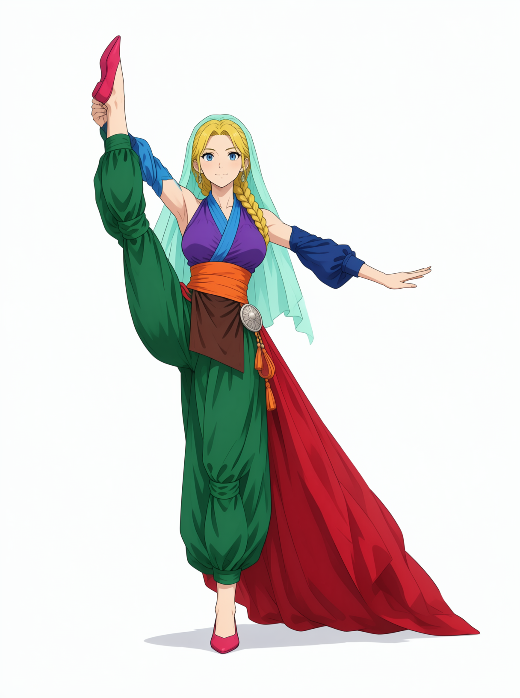</td>
<td>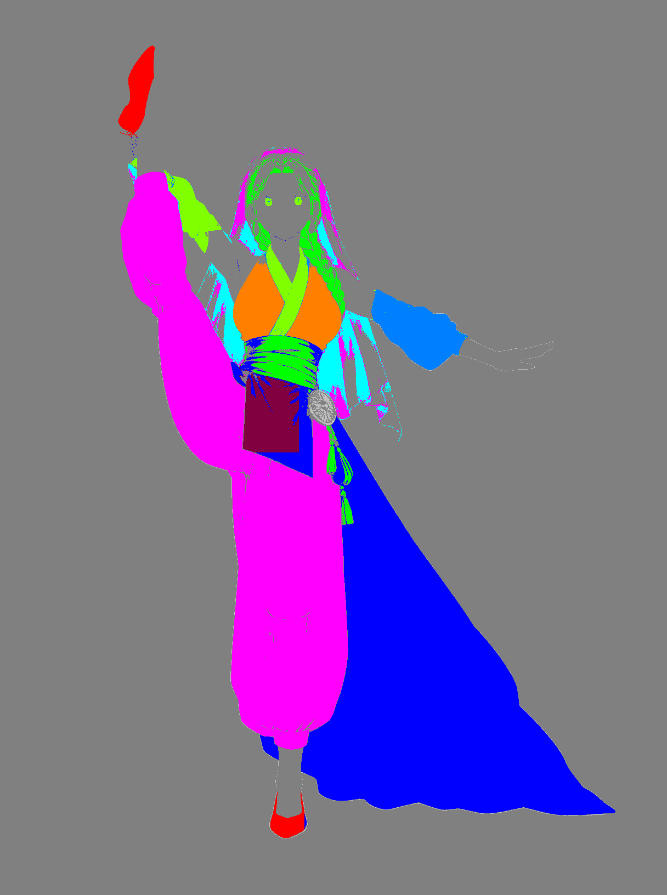</td>
</tr>
</table>

色图四条画法（每条都有实测）：

| 规则 | 原因 |
|---|---|
| **形状必须贴合衣物轮廓** | 矩形会画出多个人（实测非白 41%→81%） |
| **背景必须是中灰 `(128,128,128)`** | 白底会毁姿态（画成正面站立）、黑底也偏 |
| **色块数上限 = 互不重叠的部位数**（不是固定的 3） | 3/5/8/9 区的色块泄漏全 0.000%，颜色从来不是瓶颈；真正的瓶颈是**掩码像素重叠** —— 重叠 >90% 的两块，色图里后画的会盖掉先画的（`veil` 盖 `bodice`，胸衣饱和从 33.38 掉到 29.11） |
| **>3 区时必须 `--control-strength 1.0 --depth-strength 1.0`** | 3 区以上，色块的分区暗示会压过人体轮廓，得靠深度图把它「消化」成布料分区 |

色号用 `tools/detail_colormap.py:36` 那张 10 色板，按顺序取前 N 个即可：

```
#ff00ff  #0000ff  #00ff00  #ff8000  #8000ff
#00ffff  #ff0000  #80ff00  #ff0080  #0080ff
```

2–4 色最小色差 255，5 色起降到 127（最接近的一对是 `#ff00ff ↔ #8000ff`）。**别自己发明新颜色**，尤其别用接近参考图主色的 —— 那才会被当成填色指令。

### 设定原理

一段完整的 region prompt 是**三段式**：

```
the <色号> area is <tag>, <位置>;
its shape is: <trunk>.
Its colours, patterns and materials: <details>
```

三段各管一件事：

- **`is <tag>`** —— 把这块色区**指回 GrabTag 的裁片**。两块模块之间的桥就是这个 tag。
- **`shape is <trunk>`** —— 廓形（灯笼裤、宽袖、垂布条）。只写形状，不写材质。
- **`colours, patterns and materials`** —— 颜色 + 纹样 + 材质。信息量最大的一段：数量、排列、每条装饰的颜色和材质、附属细节。

一段真实的（`legs` 区）：

```
the #ff00ff area is legs, her legs from waist to ankle;
its shape is: wide loose trousers with a voluminous, ankle-length silhouette.
Its colours, patterns and materials: gold-thread vertical stripes running parallel
down the front of each leg; navy-edged diamond appliqués in four rows per leg,
each diamond set with a pale blue gem, linked by gold chains hung with red-brown
beads and small silver star pendants.
```

**分辨率上限 16 px 一格**（VAE stride 16）—— 能定位置，定不了比 16 px 更细的东西。所以写「四条菱形」有效，写「菱形边长 12 像素」无效。

### 为什么分成前后两段

**因为程序上注入的位置不同。**

`moss_run.py:462-491` 里 region prompt 有两条独立的路，前缀不同、注入位置相反：

| 参数 | 前缀 | 注入位置 | 代码 |
|---|---|---|---|
| `--region-prompt-head` | `Region key: ` | **拼到 prompt 最前面** | `moss_run.py:465-470` |
| `--region-prompt` | `Colour key: ` | **追加到 prompt 最后面** | `moss_run.py:472-478` |
| `--region-concat` | — | 每条编码成独立 conditioning，`ConditioningConcat` 串到正向条件后 | `moss_run.py:479-491` |

后段那两行的原文：

```python
key = "Colour key: " + " ".join(rp)
g["7"]["inputs"]["prompt"] = g["7"]["inputs"]["prompt"] + "\n\n" + key
```

为什么要这么分：

- **前段放「方位」**。`moss_run.py:467` 的注释写得很直白：「与 `--region-prompt` 同格式，但拼到 prompt 最前面（layout 的方位句原来占这个位置）」。谁在左、谁在右、谁在腰下 —— 这类空间指认要尽早出现，让模型先把骨架立起来。
- **后段放「材质」**。一段颜色=材质的映射，本质是对已成形画面的着色描述，放在最后正好接上「已经画好的轮廓该怎么填」。注释 `moss_run.py:474-475` 记录了当初的取舍：把「颜色=材质」写进**同一段提示词**，比多路 conditioning concat 有效得多，`--color-map` 只负责分区。
- **第三路（concat）是备选，不推荐**。它把每区文案编码成独立 conditioning 再串接，理论上更「干净」，实测反而不如拼成一段。

一句话：**这不是风格选择，是注入位置的产物。** 前段抢在骨架建立前说话，后段等在画面成形后着色。

### 技术实现

- **`--color-map`**：色图进入 `MOSSImageControl` 的 384 通道（128 噪声 + 128 color + 128 depth，见 `custom_nodes/comfyui-moss-ref-bias/moss_control_embedder.py:92-103`），按 16×16 latent 网格降采样，每个 latent 格取该格主色。
- **两段提示词**：都走 `TextEncodeMOSSImageEdit` 的 `prompt` 字段，只是拼接位置不同（见上表）。所以它们不会互相打断，只会在文本序列的首尾各占一段。
- **和 GrabTag 的边界**：GrabTag 走 `images.image_N`（视觉通道），region prompt 走 `prompt`（文本通道），两者独立。同一张图上同时开，是 SOP-1 的标准配置。

---

## 三、三条 SOP

把上面两块串成能重复执行的流程：

| SOP | 做什么 | 一句话做法 |
|---|---|---|
| **SOP-1 原图复刻** | 从一张参考图复刻出同款 | 切裁片 → 每片挂 tag → 色图 10 区 → region prompt 逐区描述 |
| **SOP-2 原图调整** | 只改一个部件，其余不动 | 在 SOP-1 产物上换那一块的裁片与文案，其余原样 |
| **SOP-3 更换姿势** | 保住服装、换掉姿态 | 深度图定新姿势 → 纯 T2I 过渡图 → 从过渡图提色图与第二深度图 → 8 裁片精修 |

各自的完整命令与检查点见 `notes/SOP-1-原图复刻流程.md`、`SOP-2-原图调整流程.md`、`SOP-3-更换姿势流程.md`；样本见 `examples/`。

---

## 环境要求

| 项 | 版本 |
|---|---|
| Python | 3.10+（实测 3.12.14） |
| Pillow | 13.0.0 |
| numpy | 2.5.4 |
| opencv-python | 仅 `tools/depth_to_mask.py` 需要 |
| transformers | 仅 `tools/depth_from_image.py` 需要（会拉 `depth-anything/Depth-Anything-V2-Small-hf`） |
| MOSS-Image + ComfyUI | 不在本仓库，需自行部署（本机在 `C:\MOSS-Deploy\`） |

脚本里的 `C:\MOSS-Deploy\…` 是原机器的部署路径，换机器时改这些常量即可。涉及视觉模型反写的脚本（`ground_regions` / `describe_*` / `region_ask`）需要能访问对应的模型服务。

---

## 快速开始

以 SOP-3 的 standing split 样本为例（框内是产物，可对照）：

```bash
# 第 0 步：深度图 → 人物剪影 + 背景刷黑
python tools/depth_to_mask.py 姿势深度图.png input/s4 --width 1216 --height 1632 --feather 2

# 第 1 步：纯 T2I 过渡图（只传深度图，control 收在 0.6）
python C:/MOSS-Deploy/moss_run.py --fast --w 1216 --h 1632 --seed 9001 \
  --depth-map input/s4_black.png --control-strength 0.6 --control-end 0.6 \
  --prompt-file work/prompt_trans.txt

# 第 2 步：从过渡图提色图（10 区）+ 反推第二深度图 + 从色图反推画布掩码
python tools/extract_colormap.py output/过渡图.png --palette palette11.json --out input/s4_cm.png --stats

# 第 3 步：A+B 精修（8 裁片 + 色图 + 深度图 + 画布掩码）
python C:/MOSS-Deploy/moss_run.py --fast --w 1216 --h 1632 --seed 9001 \
  --edit-format ai-toolkit --image "input/e9_legs.png:raw, …" \
  --ref-labels 'legs,drape,bodice,…' \
  --ref-query-mask-por "input/cvm_legs.png, …" \
  --color-map input/s4_cm.png --depth-map input/s4_depth2.png \
  --control-strength 0.9 --control-start 0 --control-end 1.0 \
  --image-strength 0.5 --ref-no-pos 1 \
  --prompt-file work/prompt_main_blocks.txt \
  --region-prompt-file work/rp_s4.txt
```

完整命令与每步的检查点见 [SOP-3](notes/SOP-3-更换姿势流程.md)，产物对照见 [`examples/SOP-3-…-standing-split/`](examples/)。

---

## 文件清单

下面三节按模块列出仓库里的执行文件与文档；三条 SOP 的样本另见 `examples/`。

### GrabTag

#### 执行文件

| 文件 | 作用 |
|---|---|
| [`tools/extract_colormap.py`](tools/extract_colormap.py) | 从过渡图按调色板提取色图（GrabTag 两步生成的第二步输入之一） |

#### 文档

| 文件 | 内容 |
|---|---|
| [手册-GrabTag.md](notes/手册-GrabTag.md) | 是什么、两种用法、参数 |
| [手册-GrabTag-使用.md](notes/手册-GrabTag-使用.md) | 逐步骤操作 |
| [机制-GrabTag-当前实现.md](notes/机制-GrabTag-当前实现.md) | 代码层怎么走通（参考 latent → attention KV） |
| [机制-三个定位系统-GrabTag-layout-色图.md](notes/机制-三个定位系统-GrabTag-layout-色图.md) | GrabTag vs layout vs 色图，三套定位机制的区别与重叠 |
| [流程-GrabTag两步生成-锁定版.md](notes/流程-GrabTag两步生成-锁定版.md) | 两步生成的锁定流程 |
| [2026-11-10-GrabTag-ref_tag-可见细节写法.md](notes/2026-11-10-GrabTag-ref_tag-可见细节写法.md) | `ref_tag` 六条规则：颜色/材质 + 品类 + 纹样 + 位置 |

---

### region prompt

#### 执行文件（按调用顺序）

| 文件 | 作用 |
|---|---|
| [`tools/ground_regions.py`](tools/ground_regions.py) | Qwen3-VL 做 2D grounding，按部位裁图 → `grounding.json` |
| [`tools/describe_crops.py`](tools/describe_crops.py) | 对每块裁图详细反写，产出 `--region-prompt` 草稿 |
| [`tools/describe_parts.py`](tools/describe_parts.py) | 按人体部位切图、逐块反写，主干与细节分离 → `parts.json` |
| [`tools/describe_subzones.py`](tools/describe_subzones.py) | 把部位掩码竖向切段逐段反写（拿到「几个」这类数量信息） |
| [`tools/region_ask.py`](tools/region_ask.py) | 给定一张图 + 一个位置，问「这块是什么」 |
| [`tools/bbox_to_layout.py`](tools/bbox_to_layout.py) | `grounding.json` 的 bbox + 描述 → MOSS `layout.json` |
| [`tools/parts_to_layout.py`](tools/parts_to_layout.py) | `parts.json` → 主干提示词 + layout 两条通道 |

#### 文档

| 文件 | 内容 |
|---|---|
| [手册-region-prompt.md](notes/手册-region-prompt.md) | 三段式格式、每段写什么、长度预算、常见错误 |

---

### 三条 SOP

| SOP | 用途 | 参考指标 |
|---|---|---|
| [SOP-1 原图复刻](notes/SOP-1-原图复刻流程.md) | 照参考图生成同款，拿到干净基准 | vs 参考 126.04 |
| [SOP-2 原图调整](notes/SOP-2-原图调整流程.md) | 在 SOP-1 产物上只改一个部件（例：裤子化成冰衣） | 冰衣 19.17 |
| [SOP-3 更换姿势](notes/SOP-3-更换姿势流程.md) | 人物与服装不变，换一个身体姿势 | 614 行，跪姿 + standing split 两个案例 |

#### SOP 专用执行文件

| 文件 | 作用 |
|---|---|
| [`tools/pick_parts.py`](tools/pick_parts.py) | 从 `parts_all.json` 选关键部件 → 切裁片 + 切掩码 |
| [`tools/depth_to_mask.py`](tools/depth_to_mask.py) | 深度图 → 人物剪影 mask + 背景刷黑的深度图（Otsu + 形态学 + 最大连通域 + 填洞） |
| [`tools/clean_depth.py`](tools/clean_depth.py) | 深度图背景刷纯黑（SOP 第 0 步） |
| [`tools/detail_colormap.py`](tools/detail_colormap.py) | `details[]` → 分区色图 + region prompt 文案 |

#### 样本

四个自包含样本，每个都有 `00-*` 到 `05-*` 的分步产物 + 自己的 README：

```
examples/
├── SOP-1-20261112-四星2冰蓝舞娘/          36 文件 / 6.2 MB
├── SOP-2-20261112-四星2冰衣-24step/       38 文件 / 7.5 MB
├── SOP-3-20261112-四星2跪姿/               9 文件 / 4.1 MB
└── SOP-3-20261112-四星2-standing-split/   25 文件 / 7.1 MB
```

SOP-3 样本内部结构：

```
00-depth/        深度图刷黑（ex3_black.png 喂 --depth-map，ex3_mask.png 检查用）
01-transition/   过渡图（只传 --depth-map，control 0.6 / end 0.6）
02-colormap/     色图 + 第二深度图 + 8 张画布掩码 cvm_*.png
03-prompt/       主 prompt（五块结构）+ region prompt（三段式）
04-output/       各档产物（含失败版，便于对比）
README.md        逐档量化数据与踩坑记录
```

---

## 脚本参数速查

| 脚本 | 必填参数 | 常用可选 |
|---|---|---|
| `extract_colormap.py` | `--out` | `--palette`（默认 palette11.json）、`--stats` |
| `ground_regions.py` | `--image` `--outdir` | `--labels` `--max-edge` |
| `describe_crops.py` | `--indir` `--out` | `--only` `--max-edge` |
| `describe_parts.py` | `--grounding` `--image` `--out` | `--max-edge` |
| `describe_subzones.py` | `--ref` `--mask-dir` `--out` | `--segments` |
| `region_ask.py` | — | `--region x,y,w,h` / `--point x,y` / `--question` |
| `bbox_to_layout.py` | `--grounding` | `--tags` `--out` |
| `parts_to_layout.py` | `--parts` | `--min-area` `--max-area` `--prompt` `--layout` |
| `pick_parts.py` | `--parts` `--ref` | `--w` `--h` `--prefix` `--max` |
| `depth_to_mask.py` | `<输入>` `<输出前缀>` | `--width` `--height` `--feather` `--roi` `--keep-floor` |
| `clean_depth.py` | `--depth` | `--ref` `--out` |
| `depth_from_image.py` | `<输入>` `<输出>` | 无（位置参数，模型固定 `Depth-Anything-V2-Small`） |
| `detail_colormap.py` | `--parts` | `--picked` `--input-dir` `--out-colormap` `--out-prompts` |

全部支持 `--help`。

---

## 依赖（不在本仓库）

- MOSS-Image 模型、ComfyUI 部署、`moss_run.py` / `moss_main.py`
- 参考图、素材库、训练集、过程稿
- **延伸阅读文档**：本仓库只收了三个 SOP **直接点名**的文档（15 个 notes md）。这些文档自己还会引用更多笔记（实测三层引用链上有 15 个指向本仓库外），逐条补会滚雪球，所以没全收。遇到 SOP 里提到但仓库里没有的 `.md`，那是工作区内部文档，按文件名到 `notes/` 取。

---

## 三条已验证的关键结论

1. **掩码是画布坐标，不是参考图坐标** —— `--ref-query-mask-por` 的掩码描述「画布上哪块区域允许读第 i 张参考」，换姿势后新旧几何对不上（`drape` IoU 0.00%），必须从新色图反推 `cvm_*.png`。

2. **`--control-strength` 与 `--image-strength` 各管一件事** —— 前者是色图 + 深度图的总闸（`1.0` 会让参考裁片被当成装饰画进画面，拼贴 73.4%；`0.9` 是平衡点），后者管参考对画面的整体影响（`0.5` 把拼贴压到 4.3% 而纹样不退化）。

3. **24 步会把材质词放大** —— region prompt 里写 `sheer fabric`，8 步 fast 下量刚好，24 步会被材质先验放大成完全透明（裤腿从 (129,167,185) 蓝掉到 (175,181,182) 灰白）。提高 `--image-strength` 无效，必须把 trunk 改成显式不透明。

---

## 校验记录

入库前跑过一遍实测：

| 项 | 结果 |
|---|---|
| `git fsck --strict` | 无异常 |
| 133 个文件 blob 与索引比对 | 全部一致，0 异常 |
| Markdown 相对链接 | 有效 25 个，断开 0 |
| PNG 可读性 | 84 张全部可打开（48 张为 1216×1632 主画布） |
| 12 个脚本 `--help` | 全部 rc=0，无 Warning |
| 示例 JSON 交叉引用 | SOP-1/SOP-2 各 11 部件 / 7 picked，裁片与掩码缺失 0 |
